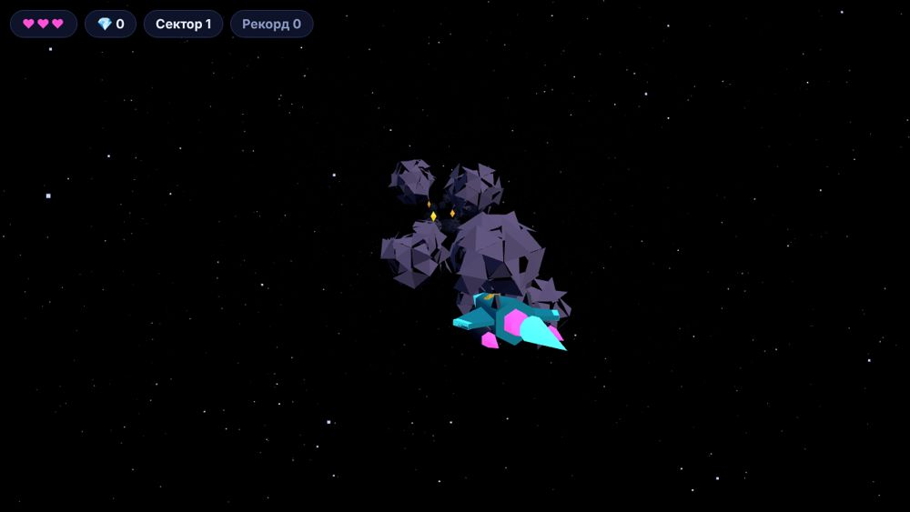

# ORBIT RUSH

3D-раннер в космосе: уворачивайся от астероидов, собирай кристаллы, проходи сектора.

**Играть:** https://yuriymldata77777-collab.github.io/orbit-rush/

## Управление
| Действие | Клавиши |
|---|---|
| Полёт | стрелки или WASD |
| Пауза | P |
| Телефон | веди пальцем по экрану |

## Технологии
- JavaScript (модули)
- [Three.js](https://threejs.org) для 3D
- Сделано вместе с Claude Code

## Запуск у себя
Открой папку в Claude Code и попроси запустить локальный сервер, или выложи на Netlify, GitHub Pages или Vercel.

## Версии
- **1.0** меню, 3 жизни, сектора, рекорд, управление с телефона
